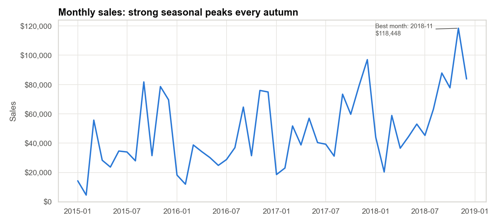
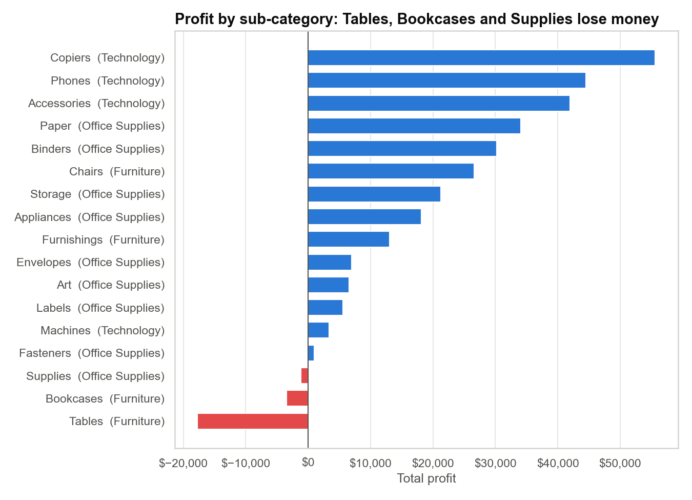
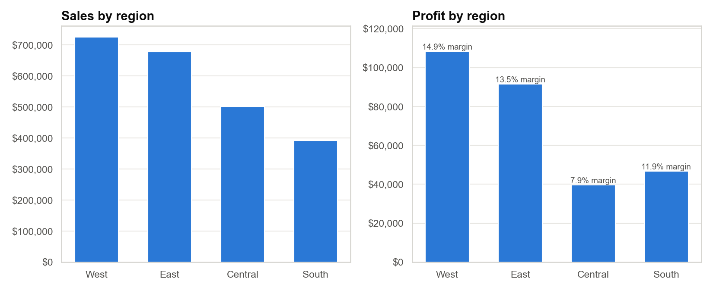
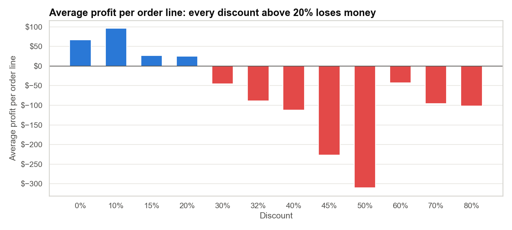
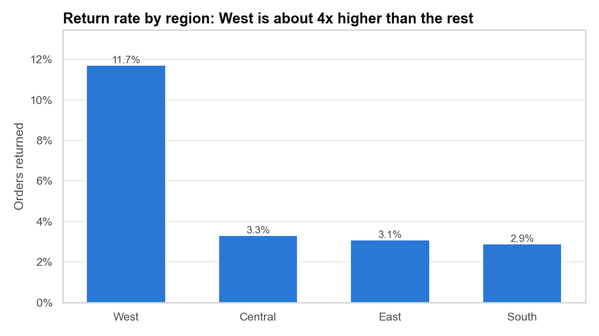

# Superstore Sales Analysis (SQL + Python)

## Problem

A US office-supplies retailer sells about $2.3M a year in products but keeps only 12.5% of that as profit.
**Which products, regions and pricing decisions are driving profit up or down, and what should the business change?**

## Data source

- **Dataset:** Sample Superstore (Tableau's sample retail data), also published on Kaggle as
  [Superstore Dataset](https://www.kaggle.com/datasets/vivek468/superstore-dataset-final).
- **Size:** 9,994 order lines, 21 columns (order and ship dates, customer, region, product, category, sales, quantity, discount, profit),
  plus a list of 296 returned orders.
- **Copy used here:** Kaggle needs a login to download, so `data/superstore.csv` comes from a public GitHub mirror
  ([leonism/sample-superstore](https://github.com/leonism/sample-superstore)). Its sales and profit numbers match the Kaggle copy.
  The dates run one year later (2015–2018 instead of 2014–2017). This copy also has the workbook's "Returns" and "People" lists
  pasted under the orders. The cleaning step separates them out.
- **To use the Kaggle file instead:** save it as `data/superstore.csv` and run the notebook again. Everything works except
  the two return-rate queries, because the Kaggle file doesn't include the Returns list.

## Tools

SQLite (SQL queries) · Python · pandas (cleaning) · matplotlib + seaborn (charts) · Jupyter

## Project structure

```
sales-analysis/
├── data/superstore.csv        raw data
├── queries.sql                14 SQL queries (Part 1: core questions, Part 2: deeper analysis)
├── sales_analysis.ipynb       cleaning, SQL, charts (run top to bottom)
├── images/                    the 5 PNG charts
└── superstore.db              SQLite database, created by the notebook (not committed)
```

## Steps

1. **Load.** Read the CSV with pandas.
2. **Clean.**
   - Found the workbook's Returns list pasted under the orders and **split it into its own table** before cleaning.
   - Missing values: dropped 806 rows that had no order date, sales or profit (the pasted-in lists).
     Filled 11 missing postal codes (Burlington, VT) with `"Unknown"` so those real orders weren't lost.
   - Duplicates: the orders had none. The Returns list had **504 duplicate order IDs** (one row per returned product),
     which were removed to leave 296 unique returned orders.
   - Data types: converted dates from text to real dates, Row ID and Quantity to whole numbers, and postal codes to text.
   - Renamed columns to `snake_case` (e.g. `Sub-Category` → `sub_category`) so they are easy to use in SQL.
3. **Load into SQLite.** Saved two tables in `superstore.db`: `orders` (9,994 rows) and `returns` (296 rows).
4. **Query.** Ran the 14 queries in [`queries.sql`](queries.sql):

   | Part | SQL used | Questions |
   |---|---|---|
   | 1. Core (Q1–Q8) | `GROUP BY`, `HAVING`, `ORDER BY`, `LIMIT`, `strftime` | Top 5 products, profit by region and category, loss-making categories, monthly trend, discount vs profit, top 10 customers |
   | 2. Deeper (Q9–Q14) | CTEs (`WITH`), window functions (`LAG`, `RANK`, running `SUM`), `LEFT JOIN`, `CASE WHEN` | Year-over-year growth, top 3 products per region, year-to-date running total, return rates by region and sub-category, discount vs product test |

5. **Visualise.** Made 5 charts from the query results and saved them to `images/`.

## Key findings

1. **Discounts above 20% are destroying profit.** Every discount level from 30% up has a negative average profit.
   These 1,393 order lines (14% of all lines) lost **$135,376**, equal to 47% of the store's total profit.
   *Is it the discount or just bad products?* Comparing the **same sub-category** at different discount levels (Q14) shows
   that margin falls as the discount rises in every sub-category. In 8 of the 9 sub-categories that were ever discounted
   over 20%, those sales lost money. So the discount itself is the main cause.

2. **The "loss-making" products are profitable at full price.** Furniture's margin is only 2.5%, compared with about 17%
   for Technology and Office Supplies. Tables (−$17,725), Bookcases (−$3,473) and Supplies (−$1,189) lose money overall.
   But sold **without a discount**, all three are profitable. Tables, for example, make an 18.5% margin at full price
   and −34.1% when discounted over 20%.

3. **West earns the most and also gets the most returns.** West has the highest profit ($108,418, 14.9% margin), but
   **11.7% of its orders are returned**, 3.5–4× the rate of every other region (2.9%–3.3%).
   Central is the weakest region: third in sales ($501K) but last in profit ($39,706, 7.9% margin).

*Also worth knowing:* sales grew 29.5% in 2017 and 20.4% in 2018, and they peak every year in September, November and December.
Copiers are the most profitable product line. The Canon imageCLASS 2200 copier is the #1 product in three of the four regions.

## Business recommendation

**Cap discounts at 20%, and require manager approval for anything higher, starting with Furniture.**
Discounts over 20% lost $135K over four years, $54K of it in Furniture. Tables, Bookcases and Supplies are profitable
at full price, so limiting discounts alone should turn them from losses into profits. They don't need to be removed from the catalog.

**Next step:** investigate West's 11.7% return rate (by product, customer and shipping mode). It is the most profitable region,
so cutting its returns protects the biggest source of profit.

## Charts

**Monthly sales trend**


**Profit by category (sub-category level)**


**Region comparison**


**Discount vs profit**


**Return rate by region**


## Limitations

- This is sample data from Tableau, not a real company, so the patterns are useful for practice but not real-world evidence.
- The discount test (Q14) compares the same sub-category but not the exact same product. A sub-category's heavily discounted
  lines may still include different products than its full-price lines.
- The returns list says which orders were returned, not which products or why, so return rates are measured per order.

## How to run

```bash
# from the data-analyst-portfolio folder
pip install -r requirements.txt
cd sales-analysis
jupyter notebook sales_analysis.ipynb   # then: Kernel → Restart & Run All
```
